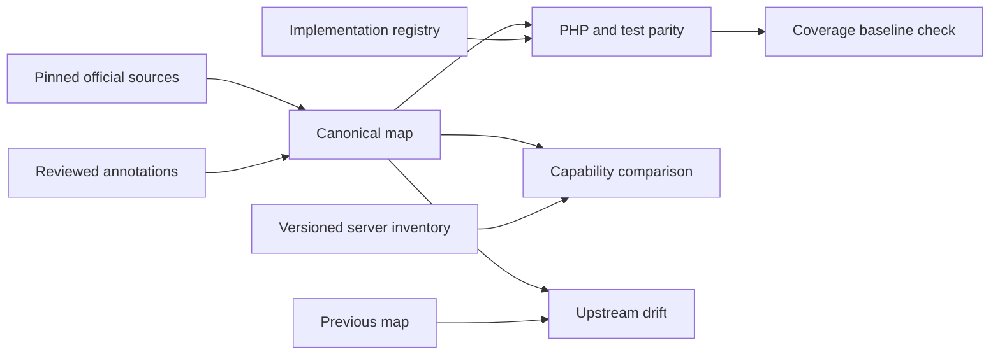

# Documentation, API map, and parity tooling

Status: approved by the user for implementation planning on 2026-10-13.
Go was selected by the user on 2026-10-13.
Beads: `whm-api-client-gwi`, with delivery tracked in its existing six children.

## Intended outcome

Give this PHP library a reproducible answer to four separate questions: what
the official API documentation describes, what the PHP library implements,
which contracts its tests cover, and what a particular server advertises.
Make upstream changes and implementation regressions reviewable without live
credentials. Initial endpoint coverage is zero; an HTTP transport is not an
endpoint implementation.

The tool targets WHM API 1 and cPanel UAPI. Legacy cPanel API 1/2, WHM API 0,
PHP endpoint implementation, Laravel integration, and mutating/destructive
server tests are outside this epic. A bridge operation belongs to WHM's map;
UAPI-through-WHM test evidence belongs to the relevant UAPI operation and
must remain distinguishable from direct UAPI authentication evidence.

The [source audit](../../api/source-audit.md) and
[manifest](../../api/sources/2026-10-13/manifest.json) establish the first inputs:
630 WHM HTTP operations and 695 UAPI variants across 693 UAPI paths, with
source version 11.138.0.10. These figures are evidence for this snapshot only.

## Approach and boundaries

Use a standalone Go module in `tools/api-map/`, producing an `api-map` binary.
It has no place in Composer's runtime dependencies or the PHP `src/` namespace.
The Go baseline is 1.24; development may use the installed newer toolchain.
Prefer standard-library JSON, hashing, HTTP, and command parsing. Use
[`go.yaml.in/yaml/v3`](https://pkg.go.dev/go.yaml.in/yaml/v3) for YAML input and
[`github.com/santhosh-tekuri/jsonschema/v6`](https://pkg.go.dev/github.com/santhosh-tekuri/jsonschema/v6)
to validate the published map/registry/report schemas. Pin dependencies in the
tool's own `go.mod` and `go.sum` during implementation.

The chosen ingestion approach is a lossless JSON-compatible source tree plus
a small normalized index. A strongly typed OpenAPI model alone risks dropping
unrecognized extensions or inconsistent vendor metadata; retaining a source
tree lets diagnostics report those inconsistencies. An SDK/code generator
would couple documentation analysis to PHP implementation and does not solve
the separate coverage/evidence questions. Rust could provide the same design,
but Go is the user's selected language and suits this standalone CLI.

Split responsibilities into source loading, reference indexing, canonical map
construction, implementation parity, capability comparison, and drift checks.
Only explicit source refresh and capability capture may access the network.
All comparison and generation commands operate on local artifacts.

## Canonical identity and transport variants

A logical operation ID is its family prefix plus exact path without the
leading slash: `whm1:accountsummary`,
`whm1:EcosystemFeatures/is_ready`, or `uapi:DomainInfo/list_domains`.
WHM preserves the complete function path, including namespaces. UAPI also
records module and function separately. Preserve spelling and case; tags and
upstream `operationId` remain source metadata, not canonical identity.

A transport variant ID adds `#` and the uppercase HTTP method, for example
`uapi:WebApp/stage#POST`. Source JSON pointers retain lowercase method keys.
The two WebApp GET/POST pairs become two logical operations with two variants
each. Each variant preserves its own query parameters and body; shared names
do not make those contracts interchangeable.

Do not synthesize undocumented variants from examples. Supplemental evidence
such as the SSL POST tutorial is recorded as a discrepancy until a reviewed
annotation explicitly admits another transport. A WHM bridge does not create
hundreds of additional synthetic UAPI transport variants.

Aliases are explicit records with source/target IDs, reason, and evidence.
Resolve them with cycle and collision checks. Never collapse two paths based
on similar names or a shared upstream ID. A possible rename in drift output
remains an added/removed pair until an explicit alias confirms it.

## Versioned map contract

Publish `docs/api/schema/api-map-v1.schema.json` using JSON Schema 2020-12.
Its normalized structure is strict; retained OpenAPI objects use their declared
OpenAPI dialect and are not misrepresented as 2020-12 response schemas.
The map has these top-level members:

| Member | Meaning |
| --- | --- |
| `schema_version` | Exact interchange version `1.0` |
| `sources` | Manifest source IDs, URLs, hashes, retrieval times, product/spec versions |
| `documents` | Complete parsed OpenAPI source trees, including components, the original Paths Object, empty path items, and extensions |
| `operations` | Sorted logical operations containing case-sensitive identity and HTTP variants |
| `aliases` | Reviewed, evidenced identity relationships |
| `annotations` | Source supplements/discrepancies, separately attributed |
| `diagnostics` | Sorted findings with severity, code, source ID, and JSON pointer or prose locator |

An operation contains `id`, `family`, `module` (null for WHM), `function`,
`path`, source provenance, and a nonempty `variants` array. A variant contains
its ID, method, operation/path-item source pointers, effective parameters/
security/servers, and an evidenced risk classification. The complete source
objects in `documents` preserve parameter/body/response schemas, defaults,
nullability, examples, deprecations, serialization fields, and all extensions
without a hand-maintained list of allowed vendor fields. Variants reference
those objects instead of duplicating their full bodies. Each effective parameter
also points to the declaration it came from.

Retaining each parsed document preserves the complete source graph even for
empty or metadata-only path items and extensions on the Paths Object. References
resolve within their original source
document, not against the surrounding map's JSON paths. Preserve schema
references rather than recursively expanding them: UAPI `ServiceAccount`
already contains a recursion cycle. Check `$ref` targets and discriminator
mapping targets with cycle-aware traversal. A legitimate schema cycle is not
an unresolved-reference error; alias cycles are errors.

Parameter inheritance follows `(name, in)` with operation declarations taking
precedence over path declarations. Duplicate declarations in one scope are
diagnostics, not last-write-wins input. Parameters expressed using `content`
are as important as those using `schema`. Requiredness, nullable false/true,
an absent default, and an explicit null default remain distinguishable. Parse
JSON numbers without float64 rounding. Reject duplicate JSON/YAML mapping keys
before a map decoder can discard them. YAML permits JSON-compatible mappings
and scalar types; reject non-string keys, custom tags, cyclic aliases, and
unbounded alias expansion with clear diagnostics.

Preserve unsupported OpenAPI fields and emit diagnostics when the normalized
view cannot interpret them. Unsupported specification versions fail explicitly.
Malformed structures, missing IDs required by the map, duplicate canonical
IDs, broken references, and hash mismatches prevent publishing a new map.
Do not silently omit a broken operation to obtain a successful build.

## Source supplements, availability, and risk

Reviewed annotations identify their source hash, JSON pointer or guide locator,
affected operation/family, kind, conclusion, and rationale. They add evidence
without modifying the pinned input. Hash changes invalidate a supplement until
it is reviewed against the new source; a refresh never silently carries it
forward as verified.

Token authentication is a family supplement because both OpenAPI documents
declare BasicAuth only. Preserve the exact upstream security requirement and
the separately documented `whm`/`cpanel` token headers. Response semantics,
nullable wire encoding, and conflicting methods remain per-operation facts or
unresolved diagnostics. The tool does not implement API request execution.

Keep all availability values in their original types/text. Structured
deprecation and reviewed prose deprecation are separately attributed.
Internal-only, CLI support, plugin, RPM, minimum-compatible-version, and rollback
fields remain present/absent exactly as published. Any derived version
comparison must identify its parsing rule; unparseable product/plugin version
strings yield unknown, not an invented ordering.

Risk values are `read-only`, `mutating`, `destructive`, or `unknown`. A source
`x-readonly:true` supports read-only classification. A false value supports
mutating classification with destructive potential explicitly unresolved;
stronger destructive classification needs a reviewed operation-specific
annotation. Missing metadata stays unknown. Conflicting evidence becomes an
unknown classification plus a diagnostic. Each classification carries evidence;
GET, function-name patterns, or absent rollback metadata never grant safety.
No classification authorizes an API call.

## CLI behavior and reproducibility

| Command | Inputs and result |
| --- | --- |
| `sources verify` | Validate manifest hashes, sizes, formats, and local source paths |
| `sources refresh` | Explicitly fetch allowlisted official inputs into a new snapshot; never overwrite an existing snapshot |
| `map build` | Pinned sources + reviewed annotations → map JSON and diagnostics |
| `parity report` | Map + PHP symbol inventory + registry → JSON and Markdown coverage reports |
| `capabilities capture` | Explicit opt-in WHM version/applist → sanitized capability profile |
| `capabilities compare` | Map + saved profile → categorized differences |
| `drift report` | Old/new maps → source-contract changes |
| `check` | Rebuild/validate local inputs and compare parity to the checked baseline |

Every command accepts explicit input/output paths. Deterministic artifacts
exclude generation-time clocks, absolute workspace paths, environment-specific
values, and random IDs. Retained source retrieval timestamps come from the
manifest. Sort normalized records by canonical IDs and object keys while
preserving semantically ordered source arrays. Write validated outputs
atomically. Emit identical bytes for identical inputs. Diagnostics go to stderr
or a selected file without corrupting JSON stdout.

Ordinary commands disable remote reference loading. Local references must stay
within the selected snapshot, including after symlink resolution. Explicit
refresh permits HTTPS sources on `api.docs.cpanel.net` and `docs.cpanel.net`,
checks redirect destinations before following them, and uses time/size limits.
External references must be fetched during refresh and added to the manifest
before offline generation can resolve them. The current inputs need no external
references. Bound source nesting, reference traversal, decompressed sizes, and
YAML expansion; failure leaves the prior selected source set intact.

## PHP and test coverage registry

Use an explicit JSON registry under `docs/api/coverage/`, with its own versioned
schema. Entries bind canonical IDs/variants to public PHP `Class::method`
symbols, status (`implemented` or `partial`), contract-unit declarations,
offline test symbols, and separately identified live evidence. Exclusions
require reasons and documentation provenance. Keep infrastructure classifications
explicit, initially including `HttpTransport`; generic dispatch does not count
as implemented endpoint coverage.

A small development-only PHP exporter uses Composer autoloading and reflection
over named project classes to emit a symbol inventory without instantiating
clients or executing endpoint methods. It checks that registered public methods
and PHPUnit test methods exist under the appropriate project directories.
Only trusted repository code is loaded. The Go comparator validates registry
links against this inventory and the canonical map. Existing symbols prove a
mapping is structurally valid, not that its assertions are semantically adequate.

Report implemented, missing, partial, deprecated/excluded, orphaned, duplicate,
and unknown mappings by family and UAPI module/WHM tag. Multiple public methods
for one operation require explicit mapping rationale instead of accidental
double counting. Unclassified public API methods are reported and cannot
inflate the numerator. A claim of full implementation requires all included
variants and declared contract units; partial work stays partial.

Coverage dimensions and denominators are independent:

- Functions: unique canonical operation IDs, with excluded IDs and gross/net
  totals shown separately. An operation is complete only when all included
  variants are complete.
- Transports: documented `(operation ID, method)` variants.
- Parameters: effective `(variant ID, name, in)` declarations; wildcard/indexed
  parameter families count as documented declarations, not arbitrary expansions.
- Body contracts: each declared `(variant ID, media type)`.
- Response contracts: each documented `(variant ID, status, media type)` schema.
  This is schema-level coverage, not a claim that every nested field was tested.
- Offline contract tests: variants with registered executable tests and their
  declared contract-unit assertions. Report the declaration separately from
  the latest test-run result; a test name alone does not prove passing coverage.
- Live evidence: verified operation/variant IDs with host, version, time, route,
  and account context. Direct UAPI and WHM bridge evidence remain distinct.

Contract-unit claims bind to source pointers and normalized contract hashes.
A changed contract makes the claim stale pending review. The initial reports
must truthfully show zero endpoint implementation/test coverage even though
the HTTP transport has its own unit tests.

## Server capability profiles

The optional collector permits only the documented WHM `version` and `applist`
operations. It requires explicit opt-in, HTTPS with certificate verification,
and a token supplied through an environment variable. The default named profile
is `test.oblak.host:2087` as WHM root, with cPanel context `npr` recorded if
provided. Other hosts require an explicit profile configuration; this server
does not define the public library's support target.

The collector has no arbitrary function argument and never probes every mapped
operation. It disallows redirects, bounds time/body size, and does not retry
unknown operations. Persist only host, version, capture timestamp, account
context, route, advertised names, and minimal sanitized result metadata.
Never persist or print the token, Authorization header, session path, or raw
diagnostic response. Use safe, fixed error categories for transport/auth/API
failures. Keep real server profiles out of routine public fixtures; use
synthetic profiles for CI.

Compare advertised WHM names with the exact documented function identities.
Report intersection, runtime-only, and docs-only sets independently from PHP
coverage. Difference annotations may record version, plugin, role/permission,
namespace/alias, or unknown explanations, with evidence and certainty. Do not
auto-resolve namespace differences or equate docs-only with unsupported.

There is no complete UAPI function inventory in the audited sources. Report
UAPI runtime enumeration as unavailable and any direct authentication evidence
as unverified until separately supplied. Features/account access data must not
be relabeled as an operation inventory. No new UAPI inventory call is invented.

## Drift and CI baseline

Compare canonical identities, transport variants, parameters, body/response
schemas, effective auth, availability, deprecation, and risk evidence. Report
description/example-only changes separately from contract changes. Source
version labels alone are insufficient; compare content hashes and normalized
contracts. Confirmed aliases explain renames without erasing the original
added/removed evidence.

Keep upstream drift, registry regressions, and capability differences in
separate report sections/artifacts. The coverage baseline records protected
implemented IDs, variants, contract hashes, and test mappings—not merely a
percentage that could improve when the denominator shrinks. Initial zero
coverage passes, but invalid/orphaned/duplicate mappings still fail. Removing a
protected implementation, changing its mapping to an unknown ID, or weakening
its contract/test claims fails even if an unrelated operation was added.

Baseline updates are explicit reviewed artifact changes; CI never rewrites
them. Adding operations upstream changes the documented denominator but is not
automatically a PHP regression. CI runs Go tests, deterministic generation,
registry/schema checks, baseline checks, and existing `composer check` using
pinned inputs. Dependency installation may need its normal package cache or
network; the actual checks need no live API services or credentials.

## Validation and delivery boundaries

Source audit completion requires hash verification, reconciled path/variant
counts, and documented contract gaps. Schema/design completion requires a
published schema, representative map examples, and recorded language choice.
The implementation must cover duplicate keys/IDs, recursive and unresolved
references, inherited parameters, query-content schemas, exact casing and
dotted/indexed names, nullable/optional distinctions, GET bodies, multiple
methods, and preserved vendor extensions.

Parity fixtures include incomplete, duplicate, orphaned, aliased, and removed
mappings. Capability fixtures cover version/plugin/namespace differences,
permission ambiguity, failed authentication, and unavailable UAPI enumeration.
Drift fixtures cover changed contracts and stable unchanged input. CI tests must
demonstrate an unchanged zero baseline passing and a removed/mis-mapped protected
implementation failing. Two builds from the same pinned sources must be
byte-identical. No live capture is necessary to validate these properties.

The existing Beads dependencies remain the delivery order: audited inputs,
schema/design, ingestion, then independent parity and capability work, followed
by drift/regression gates. The concrete implementation plan follows approval
of this written design. Commits and remote synchronization remain subject to
the repository's conservative profile.
